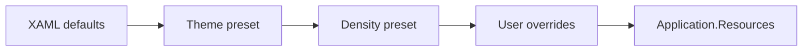

# Preferences

`PreferencesService<T>` owns the live model, persists it to `preferences.json`, and reloads
when the file is edited externally. `T` is your root preferences object; it implements
`IPreferencesModel` so the service can hook mutation tracking without knowing the section
layout.

```csharp
var prefs = new PreferencesService<MyPreferences>(dir);
prefs.Initialize();                 // create the dir, load, hook debounced auto-save
services.AddSingleton(prefs);

prefs.Current.Appearance.ThemeVariant = ThemeVariantPreference.Dark;   // auto-saves, debounced
prefs.SaveNow();                    // or flush immediately
prefs.PreferencesReloaded += (_, _) => ReapplyTheme();   // the file changed on disk
```

| Member | What |
| --- | --- |
| `Current` | The live model. Mutate it; a debounced save follows. |
| `Initialize()`, `Load()` | Create the directory and load, or reload. `LastLoadError` holds a parse failure rather than throwing. |
| `RequestSave()`, `SaveNow()` | Debounced or immediate. |
| `PreferencesMutated`, `PreferencesReloaded` | The model changed in-process, or on disk. |
| `Relocate(newBaseDir, reload)` | Move the preferences directory. |
| `BaseDirectory`, `PreferencesPath` | Where it all is. |

Hot reload runs through `DebouncedFileWatcher`, which coalesces the two or three events an
atomic write raises into one callback and lets the service suppress its own writes.

## Where the file lives

`PreferencesLocation` resolves the directory in order: a `--prefs-dir <path>` flag, an
environment variable you name, a `.location` bootstrap file at the platform default whose
contents are the real path, then the platform default itself, `%APPDATA%\{AppFolderName}` on
Windows and `~/Library/Application Support/{AppFolderName}` on macOS. The pointer is never
stored inside `preferences.json`; that would be circular.

## Appearance

`AppearancePrefs` is the app-agnostic appearance section: the theme slots for light and dark,
the variant choice (`System`, `Light`, `Dark`), the density preset, the icon pack, the UI and
mono fonts, and the accent behaviour. Embed it in your root model, or subclass it to add app
fields. The theme engines read it through `IAppearanceModel`.

## Presets and the cascade

For apps on Desktop's own `ThemeService`, a theme is a JSON preset of tokens, and the cascade
layers them:



- `TokenSchema` is the per-app allowlist mapping token names to a `TokenKind`. The cascade
  clears exactly those keys before each apply, so a removed preference reverts cleanly to the
  XAML default, and picks the right `ResourceTokens` parser per kind.
- `PresetCatalog` loads named theme and density presets: bundled ones as embedded resources,
  user ones from `{userDir}/{themes|densities}/*.json`, which override bundled presets by name.
  Theme presets ship one variant per file; density presets are variant-agnostic.
- `ResourceCascade.For(Resources, schema).ApplyTheme(theme).ApplyPreset(density).ApplyUserOverrides(...)`
  is the fluent apply. `ApplyPreset` takes an optional kind filter, which is how a density
  preset contributes only its `Size` tokens.
- `AvalloyTokens.Schema` is the baseline allowlist every app can compose its own keys into.

Apps on the [native engine](/themes/) skip all of this: their themes are hand-authored
resource dictionaries, and the appearance model only picks which one.
